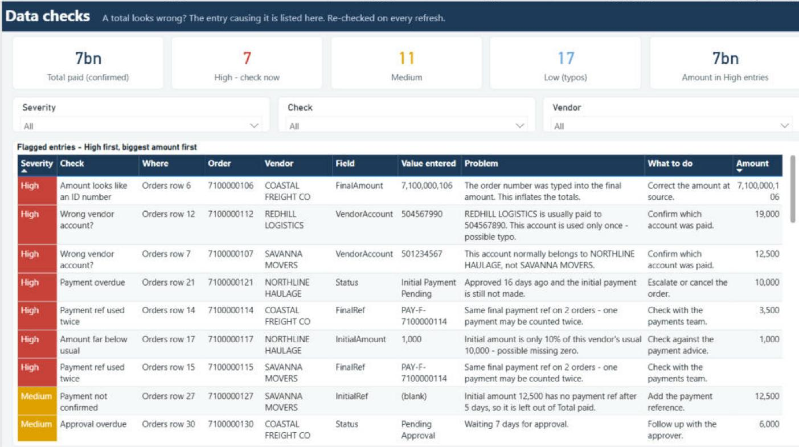

# Power BI Data Quality Toolkit

**A Power BI report that checks its own data on every refresh, and tells you exactly which record to fix.**

*The demo report on made-up data. Total paid shows 7bn because an order number was typed into an amount field. The first row of the Data checks table says so, and names the record.*

## Why this exists

In a real payments report I maintain, the headline total once jumped to billions overnight. Nothing was wrong with the visuals; someone had typed an order number into the "final amount" field. Finding that row took an afternoon.

These patterns turn that afternoon into a glance. A calculated table re-runs about 25 data-quality rules on every refresh. A **Data checks** page lists each problem with:

| Where | Field | Value entered | Problem | What to do |
|---|---|---|---|---|
| Orders row 6 | FinalAmount | 7,100,000,106 | The order number was typed into the final amount. This inflates the totals. | Correct the amount at source. |

The totals are deliberately **not** capped or filtered. An abnormal total is the alarm; the Data checks page is where you go to see why.

## What's inside

| Path | What it is |
|---|---|
| [`dax/data-checks-table.dax`](dax/data-checks-table.dax) | The self-checking calculated table (the main pattern) |
| [`dax/measures.dax`](dax/measures.dax) | Confirmed-only payment measures plus issue counts and colours |
| [`power-query/Orders.pq`](power-query/Orders.pq) | Cleaning, vendor-name standardisation (exact + fuzzy) and a 5-day completion rule |
| [`power-query/Deliveries.pq`](power-query/Deliveries.pq) | Duplicate hiding and customer-name matching: aliases, then exact, core-word and fuzzy matches, with city overrides |
| [`sample-data/`](sample-data/) | Made-up orders, deliveries and master lists with [planted problems](sample-data/README.md) |
| [`demo/Demo.pbip`](demo/) | A working Power BI project (PBIP) built from the files above |
| [`scripts/`](scripts/) | `generate_sample_data.py` makes the data; `build_demo.py` builds the demo from the pattern files |

## The checks

| Severity | Check | Catches |
|---|---|---|
| High | Amount looks like an ID number | Any amount of 1,000,000 or more; says so when it equals the order number |
| High | Amount far above / below usual | Over 2.5x, or under 30% of, the vendor's median invoice (a missing or extra zero) |
| High | Duplicate order / payment ref used twice | The same payment counted more than once |
| High | Wrong vendor account? | An account that belongs to another vendor, or a one-off account for a vendor with a usual one |
| High | Payment overdue | Approved more than 7 days ago, still unpaid |
| Medium | Payment not confirmed | Amounts with no payment reference (left out of Total paid) |
| Medium | Final paid without initial, paid before approval, approval overdue | Process steps out of order |
| Medium | Invalid order number, new vendor, unlinked or duplicate delivery | Form-entry mistakes that break joins |
| Low | Invalid vehicle or delivery number, order with no deliveries, unconfirmed customer | Housekeeping |

ID formats (order IDs start with 71, delivery IDs with 88) are examples; change them to your own in `data-checks-table.dax`.

## Try the demo

1. Install [Power BI Desktop](https://www.microsoft.com/power-platform/products/power-bi/desktop) (Windows).
2. Download or clone this repo.
3. Point the demo at your copy of the sample data, either way:
   - Run `python scripts/build_demo.py "C:\path\to\powerbi-data-quality-toolkit\sample-data"`, or
   - Open `demo/Demo.pbip`, go to **Transform data > Edit parameters** and set **DataFolder** to the `sample-data` folder (ending in `\`).
4. Click **Refresh**. You should see 7 High, 11 Medium and 17 Low flags, and Total paid at 7bn.
5. Fix row 6 in `sample-data/orders.csv` (set `FinalAmount` to `3500`), refresh, and watch the total and the flag go away.

The 5-day rule and "overdue" checks use today's date, so counts can change over time.

## Use it on your own data

1. Rename the columns in the two queries to match your source (SharePoint lists, Excel, SQL).
2. Keep the column names the DAX expects (`OrderID`, `Vendor`, `InitialAmount` and so on), or edit the `SELECTCOLUMNS` at the top of `data-checks-table.dax`. Everything below that line uses short aliases.
3. Paste the DAX as a new calculated table (**Modeling > New table**), add the measures, and build a table visual on it.

## Notes

- Built on a real project, rebuilt from scratch on made-up data. No company data, names or numbers are included.
- Developed with Claude connected to Power BI Desktop through Microsoft's Power BI Modeling MCP server.

## License

MIT, see [LICENSE](LICENSE).

Made by [Mega Anokye](https://mega-anokye.vercel.app/).
